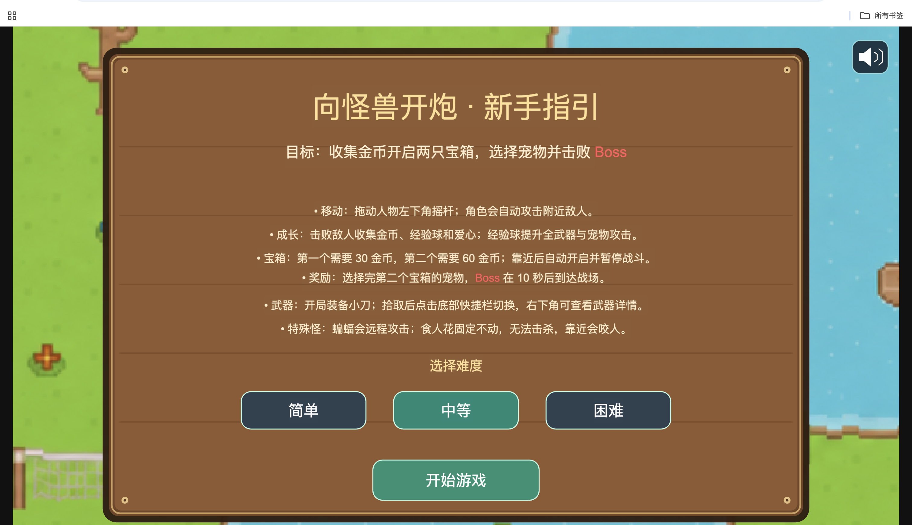
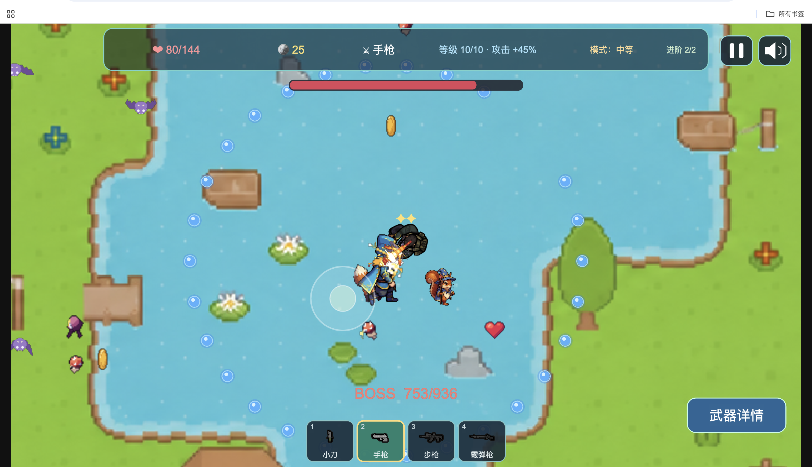

# 向怪兽开炮 · Shoot That Monster

基于 **Cocos Creator 3.8.8 + TypeScript** 开发的俯视角生存射击 H5 试玩游戏，支持鼠标与触摸操作，提供可编辑工程和单文件 HTML 试玩包。

## 游戏截图

### 新手指引与难度选择



### Boss 战与宠物技能



## 快速体验

1. 下载仓库中的 [PlayableAd_final.html](./PlayableAd_final.html)。在 GitHub 文件页选择下载原始文件，或克隆仓库后获取该文件。
2. 使用 Chrome 等浏览器打开下载后的 HTML 文件，无需安装游戏。
3. 选择简单、中等或困难模式，点击“开始游戏”。建议使用横屏体验。

> GitHub 文件页面用于查看源码，不能直接运行游戏。浏览器可能需要点击开始或声音按钮后才允许播放音频。

## 玩法

- **移动与攻击**：拖动人物左下方摇杆移动，角色自动攻击附近敌人。
- **武器切换**：初始装备小刀，拾取手枪、步枪或霰弹枪后，点击底部快捷栏切换。
- **收集与成长**：拾取金币、经验宝石和爱心，分别用于开箱、升级和恢复生命。
- **宝箱奖励**：第一个宝箱需要30金币，第二个需要60金币；靠近满足条件的宝箱后开启，获得进阶并选择宠物。
- **宠物技能**：狐狸、青蛙、幼龙和魔法松鼠分别释放火球、水柱、熔岩长矛和落石。
- **Boss战**：完成第二次宠物选择后，Boss在10秒后到达战场。击败Boss获得胜利。
- **暂停与重开**：支持查看玩法帮助、武器详情、静音、重新开始和返回主页面。

## 技术与开发环境

| 项目 | 说明 |
| --- | --- |
| 引擎与编辑器 | Cocos Creator 3.8.8 |
| 开发语言 | TypeScript |
| 开发系统 | macOS |
| 设计分辨率 | 1280 × 720，横屏 |
| 构建目标 | Web Desktop |
| 试玩交付 | 单文件 HTML |
| 辅助开发 Agent | Codex，GPT-6.1 Sol |

## 本地开发

```bash
git clone https://github.com/guzhendekabula/Shoot_That_Monster.git
```

1. 安装 Cocos Creator **3.8.8**，通过 Cocos Dashboard 导入克隆后的项目根目录。
2. 等待编辑器完成资源导入与脚本编译。
3. 打开 [assets/Main.scene](./assets/Main.scene)，使用编辑器预览功能运行游戏。
4. 在浏览器中检查交互、画面、音频及控制台输出。

本项目由 Cocos Creator 管理编译和运行，没有配置 `npm start` 或 `npm run build` 命令。首次导入会重新生成缓存，耗时取决于设备和资源导入情况。

## 构建与试玩包

在 Creator 的构建发布面板中选择 **Web Desktop**，确认启动场景为 `Main` 后执行构建，并通过编辑器提供的运行入口验证构建结果。

仓库中的 `PlayableAd_final.html` 是已生成的单文件试玩包。修改源码或重新执行标准 Web 构建不会自动更新该文件；交付时需要重新完成单文件打包，并验证包体与当前源码一致。本仓库未包含单文件打包脚本。

## 工程结构

```text
assets/
  Main.scene            启动场景
  scripts/              游戏逻辑
  resources/game/       运行时加载的图像、动画、图集与音频
  art/                  图像素材及相关原始资源
  audio/                音频素材
build-templates/        Web 构建模板
preview-template/       编辑器预览模板
settings/               Cocos 项目设置
package.json            工程及 Creator 版本信息
PlayableAd_final.html   单文件试玩包
```

`library/`、`temp/`、`build/`、`profiles/` 等缓存或构建产物目录已忽略，不纳入版本管理。

## 资源来源

项目选用免费素材，具体使用范围遵守各作者的原始许可。免费获取不代表可以任意再分发素材，转载或复用前请查阅对应资源包的许可文件。

| 资源 | 来源 |
| --- | --- |
| 地图像素素材 | [Kenney · Roguelike/RPG pack](https://kenney.nl/assets/roguelike-rpg-pack) |
| 主角动画 | [Animated Top Down Survivor Player · OpenGameArt](https://opengameart.org/content/animated-top-down-survivor-player) |
| 普通怪物 | [Free Monster Pack · Frakassets](https://frakassets.itch.io/free-monster-pack) |
| Boss | [Free Animated Monsters · GegX](https://gegx.itch.io/free-animated-monsters) |
| 武器图像 | [Military Weapon Pack · LuxiUxi](https://luxiuxi.itch.io/military-weapon-pack-free) |
| 开枪特效 | [Pixel Gun FX · obsidiansirens](https://obsidiansirens.itch.io/pixel-gun-fx)，免费示例内容 |
| 宠物 | [Pets & Companions Free · GegX](https://gegx.itch.io/pets-companions-free) |
| 宠物技能特效 | [Pixel Magic Effects · Foozle](https://foozlecc.itch.io/pixel-magic-sprite-effects) |
| 金币、经验宝石、回血爱心 | [SpritePilot · Pickups](https://spritepilot.com/free-game-assets/pickups) |
| 音效 | [Pixabay](https://pixabay.com/sound-effects/)、[SFXMint](https://sfxmint.com/)、[Kenney](https://kenney.nl/assets) |

**地图由开发者取得 Kenney 像素素材后，自行设计布局、绘制和拼接完成，并非直接采用现成的完整地图。**

木质公告栏、按钮、摇杆、血条和部分弹体由程序绘制。音效表记录来源平台，单个音频的来源与许可应以原始下载记录为准。
